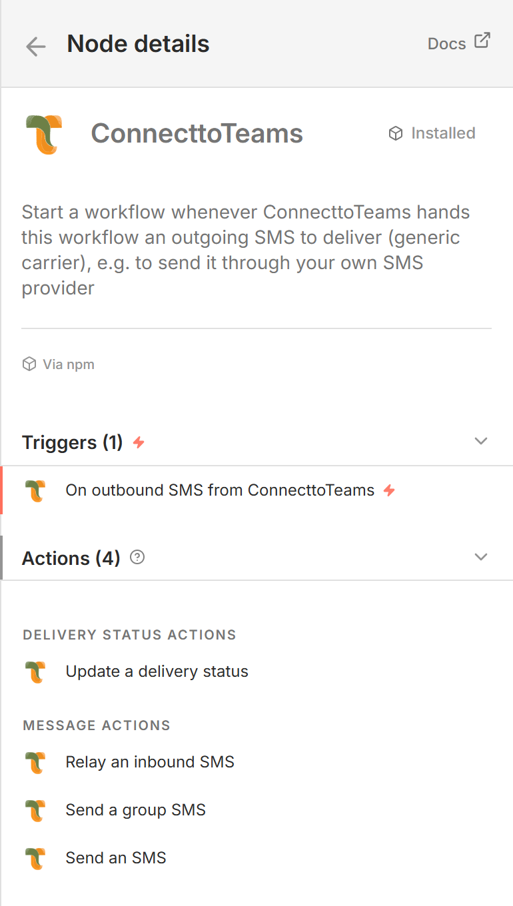

# ConnecttoTeams for n8n — node guide

This guide explains what the `n8n-nodes-connecttoteams-connector` package adds
to n8n: each action and the trigger, what it is for, every parameter, and what
it outputs. Screenshots are from n8n 2.14.

**ConnecttoTeams** lets a business's phone numbers send and receive SMS inside
Microsoft Teams. Each business phone number is a **DID**. The **SMS Responder**
is ConnecttoTeams' messaging backend; every action in this package talks to it.

## Find it in n8n

Open the node panel (**+**), search for **ConnecttoTeams** and open it. You see
its actions and its trigger:



```
ConnecttoTeams
  MESSAGE ACTIONS
    Send an SMS
    Send a group SMS
    Relay an inbound SMS
  DELIVERY STATUS ACTIONS
    Update a delivery status
  TRIGGERS
    On outbound SMS from ConnecttoTeams   (the ConnecttoTeams Trigger)
```

The four actions are operations of one node, **ConnecttoTeams**. After adding
it you can switch action with its **Resource** and **Operation** fields. The
trigger is a separate node.

## Actions and trigger

| In the panel | Page | Use it to | Credential |
|--------------|------|-----------|------------|
| Send an SMS | [Send SMS](send-outbound-sms.md) | Send a text or picture message from one of your DIDs to one recipient | ConnecttoTeams Enterprise API |
| Send a group SMS | [Send Group SMS](send-outbound-group-sms.md) | Send one group text from one of your DIDs to several recipients | ConnecttoTeams Enterprise API |
| Relay an inbound SMS | [Relay Inbound SMS](sms-to-connecttoteams.md) | Deliver an inbound SMS/MMS from a customer into the matching Teams conversation | ConnecttoTeams Enterprise API |
| Update a delivery status | [Update Delivery Status](delivery-status-update.md) | Report whether the carrier delivered or rejected a message you sent | ConnecttoTeams Enterprise API |
| On outbound SMS from ConnecttoTeams | [ConnecttoTeams Trigger](sms-from-connecttoteams-trigger.md) | Start a workflow when ConnecttoTeams hands n8n an outgoing SMS to deliver (generic carrier), e.g. through your own SMS provider | ConnecttoTeams Gateway API |

Set up the credentials first: [Credentials](credentials.md).

## How they fit together

```
                    ┌─────────────────── your SMS provider ───────────────────┐
                    │                                                          │
Teams user replies  │                                        customer texts    │
        │           ▼                                        your DID          ▼
        │   ConnecttoTeams Trigger ──► send via provider      provider webhook
        │   (outputs carrier_msg_id)                │                         │
        │                                           ▼                         ▼
        │                          provider reports delivery         Relay Inbound SMS
        │                                           │                         │
        │                                           ▼                         ▼
        │                          Update Delivery Status            message appears in
        │                          (Message ID = carrier_msg_id)          Teams
        │
Your data (sheet, CRM, form) ──► Send SMS / Send Group SMS ──► customer
```

- **Outbound through your own provider (generic carrier):** the trigger
  receives each message a Teams user sends, your workflow passes it to your
  provider, and Update Delivery Status reports the outcome back.
- **Inbound:** your provider's webhook starts a workflow, and Relay Inbound
  SMS puts the message into Teams.
- **Messages started by n8n:** the two send actions send from your DID
  directly, e.g. one message per row of a spreadsheet.

## Common behavior of the actions

- **One request per input item.** Each field can be an expression, mapped from
  the item.
- **Phone numbers in any common format:** `+14134144414`, `14134144414`,
  `4134144414` and `(413) 414-4414` all work. Spaces are not separators, so
  `(413) 414-4414` is one number. Lists are separated by commas, semicolons or
  new lines.
- **Continue On Fail** is supported. A failed item is output as
  `{ "error", "http_code", "response" }` instead of stopping the workflow.
- **Errors show the SMS Responder's own message**, for example:

  | HTTP | Example message | Usual cause |
  |------|-----------------|-------------|
  | `400` | `Missing or invalid destination phonenumber` | A required number is empty or not a phone number |
  | `400` | `SMS gateway rejected the credentials for … (HTTP 401): …` | The generic carrier's gateway (e.g. the trigger) refused the send |
  | `401` | `Unauthorized request` | The Access Token doesn't belong to the DID |
  | `404` | `No message with message_id "x" sent from 15551230000` | Update Delivery Status: no sent message has that ID |

> The nodes send to the production ConnecttoTeams SMS Responder
> (`smsbot.connecttoteams.com`).
