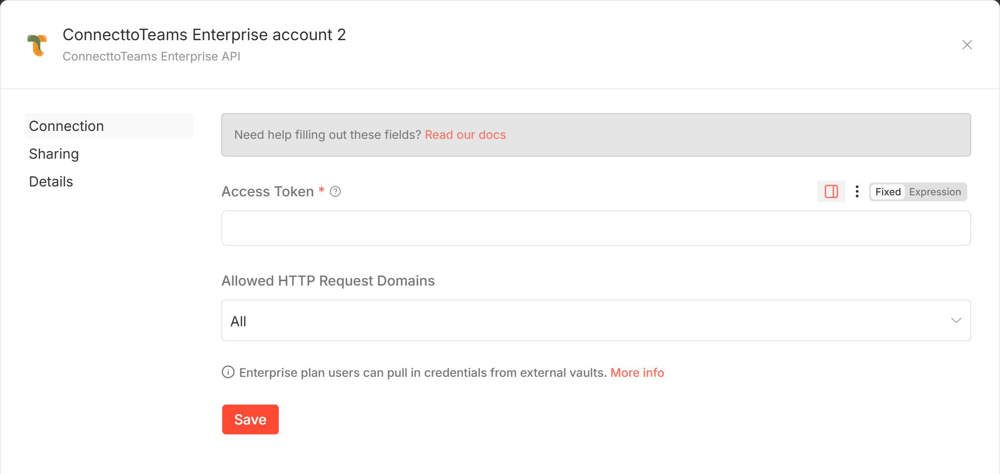
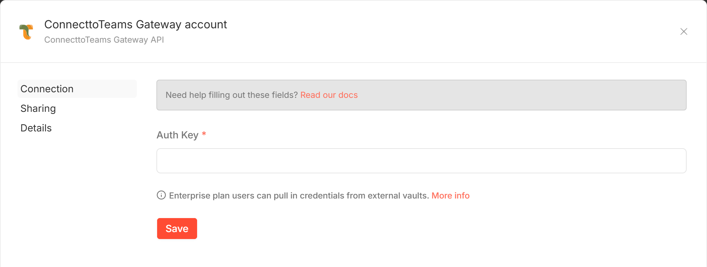

# Credentials

The package has two credentials. The ConnecttoTeams node's actions use **ConnecttoTeams
Enterprise API**; the trigger uses **ConnecttoTeams Gateway API**. They hold
different secrets and are not interchangeable.

[Back to the node guide](README.md)

## ConnecttoTeams Enterprise API

Used by Relay Inbound SMS, Send SMS, Send Group SMS and
Update Delivery Status. It proves to the SMS Responder that the workflow may
act for a DID.

| Field | Required | Description |
|-------|----------|-------------|
| **Access Token** | Yes | The token ConnecttoTeams issued for the DID, found in the ConnecttoTeams portal. Enterprise admins can request it from their reseller. |
| Allowed HTTP Request Domains | No | n8n's own setting for using the credential in the HTTP Request node. Leave it as **All**. |

**Which DID the token must belong to:**

| Action | Token is checked against |
|------|--------------------------|
| Send SMS, Send Group SMS | **Source** (the DID sending) |
| Update Delivery Status | **Source** (the DID that sent the original message) |
| Relay Inbound SMS | **Destination** (the DID that received the message) |

A token for a different DID gets `401 Unauthorized request`.

**One workflow, several DIDs:** the token is per DID, so set Access Token to an
expression such as `{{ $json.token }}`. It is resolved for each input item.

If the Access Token is empty for an item, the node stops with *"The
ConnecttoTeams Enterprise API credential has no Access Token for this item."*
and sends nothing.

The credential has no **Test** button on purpose: the only endpoints that
accept the token send or relay a real message.

## ConnecttoTeams Gateway API

Used by the ConnecttoTeams Trigger. It is the shared secret
ConnecttoTeams presents to **your** n8n webhook, so only ConnecttoTeams can
start the workflow.

| Field | Required | Description |
|-------|----------|-------------|
| **Auth Key** | Yes | Must equal the `api_secret` of the generic carrier that points at the trigger's webhook. ConnecttoTeams sends it as `Authorization: Bearer <key>` on every request; anything else is rejected with `401` and the workflow does not start. |

ConnecttoTeams sets the generic carrier's `api_secret`. Ask them for it, or
give them the key you chose, so both sides match.

> **Changing a key:** ConnecttoTeams caches carrier settings for up to 10
> minutes. After rotating the Access Token or the generic carrier's
> `api_secret`, the old value may still be used for that long.
