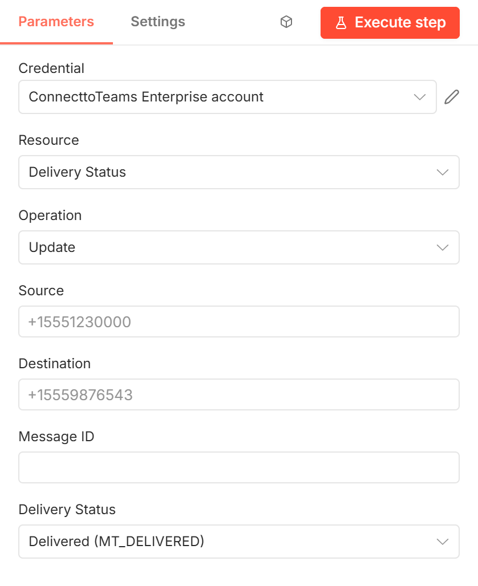
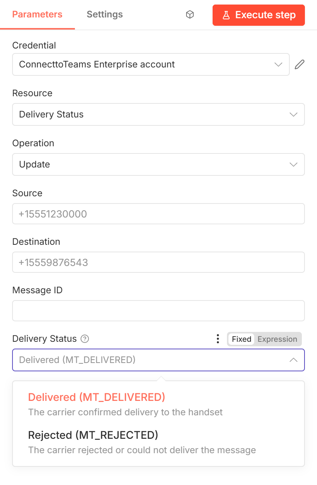

# ConnecttoTeams → Update Delivery Status

Reports what the carrier said happened to a message you sent: **delivered** or
**rejected**. ConnecttoTeams updates the message, so Teams and reporting show
the real outcome instead of stopping at "sent".

[Back to the node guide](README.md)



## When to use it

A send only tells you the message reached the carrier. If your carrier reports
delivery later (its own webhook, a polling job, a status feed), feed that
result back with this action. Typical uses:

- Mark a message that never arrived as rejected, rather than leaving it
  ambiguous.
- Build delivery-rate reports per carrier or DID from real receipts.
- Alert or retry as soon as a carrier reports a failure.

With the [ConnecttoTeams Trigger](sms-from-connecttoteams-trigger.md),
this is how your workflow reports the result of each message it delivered.

## Parameters

| Parameter | Required | Example | Description |
|-----------|----------|---------|-------------|
| **Credential** | Yes | — | A [ConnecttoTeams Enterprise API](credentials.md#connecttoteams-enterprise-api) credential whose token belongs to **Source**. |
| **Source** | Yes | `+15551230000` | Your DID that sent the original message. |
| **Destination** | Yes | `+15559876543` | Who the original message was sent to. |
| **Message ID** | Yes | `SM2f1c…` | The original message's `carrier_msg_id`: from the output of Send SMS / Group SMS, or, for the generic carrier, the `carrier_msg_id` output by the trigger. It must be a message sent from **Source**. |
| **Delivery Status** | Yes | Delivered | **Delivered (MT_DELIVERED)** or **Rejected (MT_REJECTED)**. No other values are accepted. |



To set the status from data, switch **Delivery Status** to **Expression** and
return exactly `MT_DELIVERED` or `MT_REJECTED`, e.g.
`{{ $json.status === 'delivered' ? 'MT_DELIVERED' : 'MT_REJECTED' }}`.

## Output

```json
{ "message": "Received JSON message", "content": "MT_DELIVERED" }
```

## Errors

- `404 No message with message_id "…" sent from …`: no message with that ID
  was sent from Source. Check the Message ID mapping and that Source is the
  sending DID.
- `401 Unauthorized request`: the token doesn't belong to **Source**.
- `400`: Delivery Status is not `MT_DELIVERED` or `MT_REJECTED` (only possible
  with an expression).

## Notes

- The ConnecttoTeams node can be attached to an n8n AI Agent as a tool. The workflow
  builder picks the action when attaching it, so an agent can only report delivery
  status if a builder deliberately attaches this action; receipts should come from
  the carrier.
