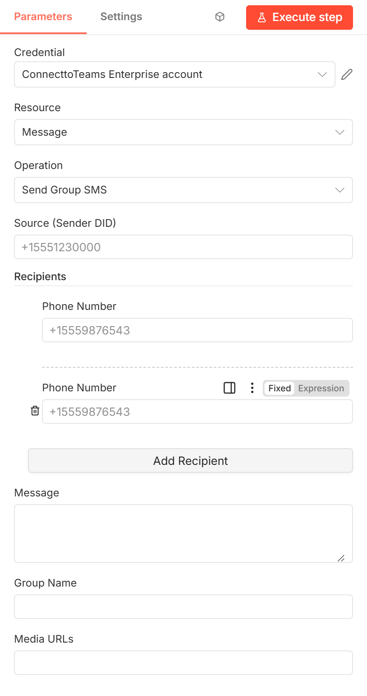

# ConnecttoTeams → Send Group SMS

Sends **one group text** (SMS or MMS) from one of your DIDs to several
recipients. Everyone is in the same conversation, and it appears in Teams as a
single group chat.

[Back to the node guide](README.md)

## When to use it

When the recipients should see each other and reply to the whole group, such
as a job crew or a family. To send the same message **individually** to many
people, use [Send SMS](send-outbound-sms.md) with one item per
recipient instead.

**Before you start:** the Source DID must be set up in the ConnecttoTeams
portal.

## Parameters

| Parameter | Required | Example | Description |
|-----------|----------|---------|-------------|
| **Credential** | Yes | — | A [ConnecttoTeams Enterprise API](credentials.md#connecttoteams-enterprise-api) credential whose token belongs to **Source**. |
| **Source (Sender DID)** | Yes | `+15551230000` | Your DID to send from. It is added to the group automatically. |
| **Recipients** | Yes | `+15559876543` | The other participants. Click **Add Recipient** to add a row per number. A row can also hold several numbers separated by commas, semicolons or new lines, or an array from an expression. |
| **Message** | Yes | `Crew: site opens at 7am tomorrow.` | Text of the message. |
| **Group Name** | Yes | `Site crew` | Name of the group conversation in Teams. Every send sets it, replacing a different stored name, so later incoming group texts keep it. A send without one is refused (*"Send Group SMS requires a Group Name."*). |
| **Media URLs** | No | `https://example.com/site-plan.png` | Publicly reachable image URLs for an MMS, separated by commas or new lines, or an array from an expression. |

## Output

The same fields as [Send SMS](send-outbound-sms.md#output), with
`"type": "group_text"`, `"action_type": "MMS"`, and `group_name` /
`group_recipients` filled in. `group_recipients` lists every participant,
including your DID.

## Errors

The same as [Send SMS](send-outbound-sms.md#errors).

## Upgrading a saved workflow

This action replaces the old **Send Outbound Group SMS** node. Workflows built
with that node must be rebuilt with this action; its **Destination(s)** field is
now **Recipients** (internal name `recipients`).
