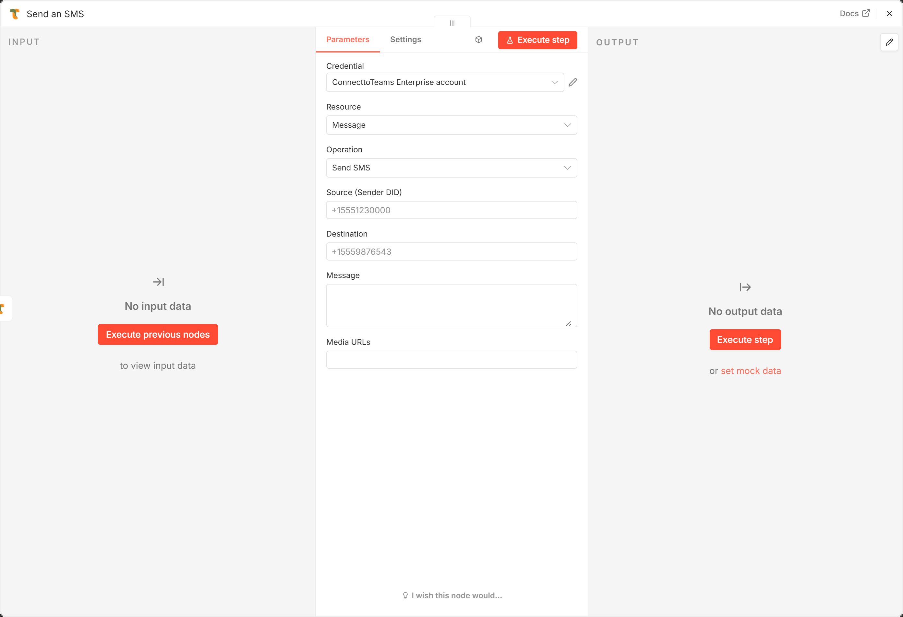
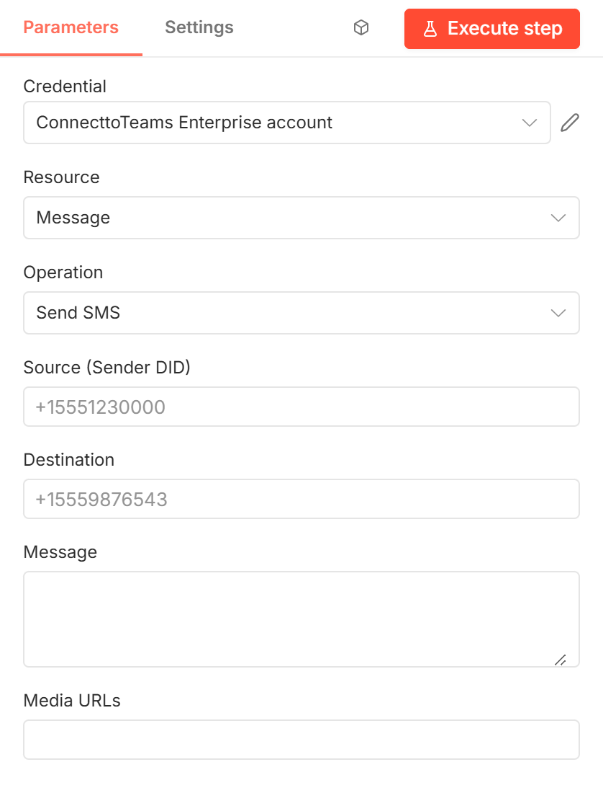

# ConnecttoTeams → Send SMS

Sends a text or picture message from one of your DIDs to **one** recipient.
The message also appears in the matching Teams conversation.

[Back to the node guide](README.md)



## When to use it

Messages that start in n8n: appointment reminders from a spreadsheet, order
updates from a CRM, a reply to a web form. Each input item sends one message.
For several recipients in one conversation, use
[Send Group SMS](send-outbound-group-sms.md).

**Before you start:** the Source DID must be set up in the ConnecttoTeams
portal. ConnecttoTeams picks the carrier from that DID; the action has no
carrier settings.

## Parameters



| Parameter | Required | Example | Description |
|-----------|----------|---------|-------------|
| **Credential** | Yes | — | A [ConnecttoTeams Enterprise API](credentials.md#connecttoteams-enterprise-api) credential whose token belongs to **Source**. |
| **Source (Sender DID)** | Yes | `+15551230000` | Your DID to send from. |
| **Destination** | Yes | `+15559876543` | Exactly one phone number. A list (commas, semicolons or new lines) is rejected; use Send Group SMS instead. |
| **Message** | Yes | `Your appointment is confirmed for 3pm.` | Text of the message. |
| **Media URLs** | No | `https://example.com/map.png` | Publicly reachable image URLs for an MMS, separated by commas or new lines, or an array from an expression. |

Numbers from an expression may be numeric, e.g. a phone number stored as a
number in Google Sheets.

## Output

The stored message record (numbers come back without the `+`):

```json
{
  "smsr_id": 482913,
  "to": "15559876543",
  "from": "15551230000",
  "message": "Your appointment is confirmed for 3pm.",
  "action_type": "SMS",
  "direction": "outbound",
  "status": 200,
  "delivery_status": "SENT",
  "carrier_msg_id": "SM2f1c0e9a7b4d4a11b3c2d1e0f9a8b7c6",
  "type": "broadcast_sms",
  "errors": null
}
```

Keep `carrier_msg_id` if the carrier reports delivery later: it is the
**Message ID** for [Update Delivery Status](delivery-status-update.md).

## Errors

- `401 Unauthorized request`: the token doesn't belong to **Source**.
- `400 Missing or invalid destination phonenumber`.
- `400 SMS gateway rejected the credentials …`: the DID uses a generic carrier
  and its gateway (e.g. the trigger) refused the Auth Key.
- *"Send SMS accepts exactly one destination…"*: Destination held a
  list.

## Example

**Google Sheets** (*Get Rows*) → **Send SMS** with Source
`+15551230000`, Destination `{{ $json.phone }}`, Message
`Hi {{ $json.name }}, your appointment is at {{ $json.time }}.`
