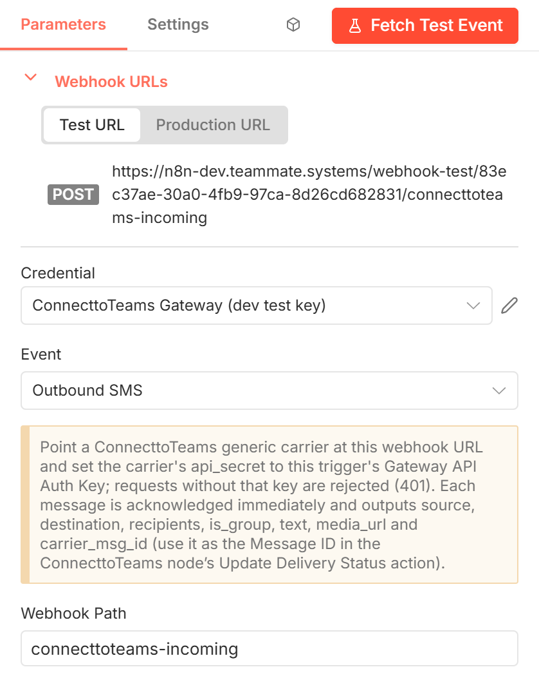

# ConnecttoTeams Trigger

Starts a workflow whenever ConnecttoTeams hands n8n an **outgoing** SMS to
deliver. Use it when ConnecttoTeams sends through a **generic carrier**, that
is, when n8n (and your own SMS provider) does the actual sending.

[Back to the node guide](README.md)

## When to use it

A Teams user replies to a customer. ConnecttoTeams posts that message to this
trigger's webhook, and your workflow sends it through your provider (Twilio,
an SMPP gateway, an HTTP API, …). Afterwards, report the outcome with
[Update Delivery Status](delivery-status-update.md).

## Setup

1. Add the trigger as the first node of a workflow: in the node panel open
   **ConnecttoTeams** and choose **On outbound SMS from ConnecttoTeams**.
2. **Credential:** create a [ConnecttoTeams Gateway API](credentials.md#connecttoteams-gateway-api)
   credential. Its Auth Key must equal the generic carrier's `api_secret`.
3. **Webhook Path:** keep the default or choose your own (see below).
4. Activate (publish) the workflow, open the node and copy the
   **Production URL** under **Webhook URLs**.
5. In ConnecttoTeams, set the generic carrier's URL (its **Callback URL**) to
   that production URL. Until then, nothing reaches the trigger.

Use the **Test URL** only while building: it works for a single request after
you click **Fetch Test Event**.

## Parameters

| Parameter | Required | Default | Description |
|-----------|----------|---------|-------------|
| **Credential** | Yes | — | A ConnecttoTeams Gateway API credential. |
| **Event** | Yes | Outbound SMS | The event that starts the workflow. There is one: **Outbound SMS**, a message sent from Teams for your workflow to deliver. It is why the node panel lists the trigger as "On outbound SMS from ConnecttoTeams". |
| **Webhook Path** | Yes | `connecttoteams-incoming` | The last segment of the webhook URL. n8n puts an ID before it, so the URL is `POST /webhook/<ID>/<path>`; always copy the full Production URL from the node. Must be unique across your active workflows; give each trigger its own path, e.g. one per generic carrier or DID. |

The yellow notice in the node summarizes the setup and the output fields.

## What happens on each request

1. The request must carry `Authorization: Bearer <Auth Key>`. A missing or
   wrong key gets `401 { "error": "Invalid or missing gateway auth key" }`, and
   the workflow does not start. ConnecttoTeams records the message as failed
   with a credentials error.
2. The trigger answers **immediately** with `{ "carrier_msg_id": "<uuid>" }`.
   ConnecttoTeams stores that ID on the message, so it does not wait for your
   workflow to finish.
3. The workflow then runs with one item.

## Output

Every item has exactly these fields, whatever was posted, so you can map them
in later nodes before the trigger has ever run:

| Field | Type | Example | Notes |
|-------|------|---------|-------|
| `source` | string | `+15551230000` | Your DID that is sending |
| `destination` | string | `+15559876543` | `recipients` joined with commas; a single number for 1:1 |
| `recipients` | string[] | `["+15559876543"]` | Every number to deliver to. For a group, everyone except the sender |
| `is_group` | boolean | `false` | `true` for a group text |
| `text` | string | `Thanks, see you at 3pm` | Message body |
| `media_url` | string[] | `["https://…/image.jpg"]` | Image URLs for MMS; empty for SMS |
| `carrier_msg_id` | string | `5b0c…-…` | The ID sent back to ConnecttoTeams. Use it as **Message ID** in Update Delivery Status |

Phone numbers are in E.164 format with a leading `+`.

## Example

`ConnecttoTeams Trigger` → **HTTP Request** to your provider (map
`source`, `destination`, `text`, `media_url`) → **IF** the provider accepted it
→ **ConnecttoTeams → Update Delivery Status** with Message ID
`{{ $('ConnecttoTeams Trigger').item.json.carrier_msg_id }}`.

## Notes

- The node panel may also list **ConnecttoTeams Trigger Tool**. It is
  an n8n-generated variant for AI agents and isn't meant to be used; use the
  plain trigger.
