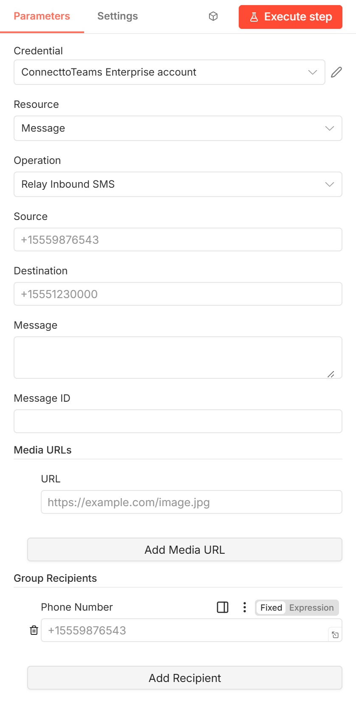

# Relay Inbound SMS

Delivers an **inbound** SMS or MMS, sent by a customer to one of your DIDs,
into the matching Teams conversation.

[Back to the node guide](README.md)



## When to use it

Your SMS provider receives a customer's message and calls an n8n webhook.
This action relays it into ConnecttoTeams, where staff see it in Teams and can
reply. Each input item is one message; with several input items, it sends one
message per item.

## Parameters

| Parameter | Required | Example | Description |
|-----------|----------|---------|-------------|
| **Credential** | Yes | — | A [ConnecttoTeams Enterprise API](credentials.md#connecttoteams-enterprise-api) credential whose token belongs to **Destination**. |
| **Source** | Yes | `+15559876543` | The customer's number, who sent the message ("from"). |
| **Destination** | Yes | `+15551230000` | Your DID that received the message ("to"). |
| **Message** | No | `Can I move my appointment?` | Text of the message. |
| **Message ID** | No | `SM8f2c…` | Your provider's ID for the message. Stored as the message's `carrier_msg_id`. |
| **Media URLs** | No | `https://example.com/image.jpg` | Images for an MMS. Click **Add Media URL** for each URL; a row can also hold several URLs separated by commas or new lines, or an array from an expression. |
| **Group Recipients** | No | `+15552220000` | Only for group conversations: the **other** participants. Click **Add Recipient** for each number. Leave empty for a normal 1:1 message. |

### Group conversations

Leave **Group Recipients** empty for a 1:1 message. To put the message into a
group Teams conversation, list the other participants in any format. The
SMS Responder adds your DID (Destination) and leaves out the sender (Source)
itself, so the message lands in the same group conversation as an outbound
group text to those numbers. If the list ends up containing only your DID, it
is treated as 1:1.

## Output

```json
{ "message": "Received JSON message", "content": "RECEIVED" }
```

## Errors

- `401 Unauthorized request`: the credential's token doesn't belong to
  **Destination**.
- `400 Missing or invalid …`: Source or Destination is empty or not a phone
  number.

See [common errors](README.md#common-behavior-of-the-actions).

## Notes

- The ConnecttoTeams node can be attached to an n8n AI Agent as a tool. The workflow
  builder picks the action when attaching it, so an agent can only relay inbound
  messages if a builder deliberately attaches this action.
- It doesn't need to be right after the trigger; acknowledging your provider
  is the webhook node's job.
